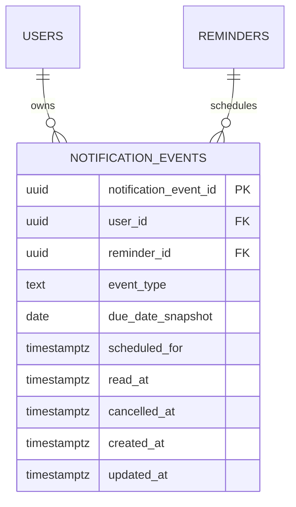

# Notification Phase1 ERD delta

**Cập nhật:** 2026-10-11 (VN) · **Application baseline:** `main` `bcd14b51f4b70cd3d418bd10638f7a996713fdcf`  
**Đã triển khai:** PR #26 đã merge, [Vercel Production success](https://vercel.com/lemai-rgbs-projects/m-mincare/E3bmui2BdzU7iAzkP2kNtnM4XSLD).  
[Ứng dụng](https://m-mincare.vercel.app/) · [Trải nghiệm thử](https://m-mincare.vercel.app/demo)

This focused ERD remains part of the deployed schema. Owner read/current-event selection, due-date snapshots/cancellation and active-schedule indexes are defined in [Data Dictionary](Data_Dictionary.md) and [Business Rules](MMinCare_Business_Rules.md). Full editable diagrams: [ERD](ERD%20-%20WEB%20MMin%20Care.drawio). Demo notification snapshot IDs are browser-local, not production event UUIDs.

