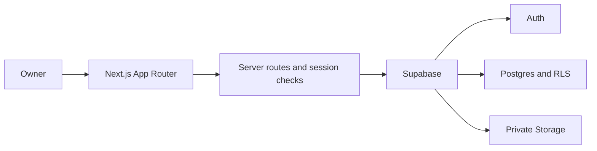

# MMinCare

**Care more, worry less.**

MMinCare is a responsive web application that helps dog and cat owners keep pet profiles, vaccination history, medical records, health observations, and care reminders in one place.

[Open the live application](https://m-mincare.vercel.app/) · [Review the MVP](Product/MVP%20document.md) · [Read the business rules](MMinCare_Business_Rules.md) · [Explore the API](MMinCare_API_Documentation.md)

> MMinCare is a pet-care record management product. It does not diagnose medical conditions or replace professional veterinary advice.

## Product problem

Pet health information is often scattered across paper vaccination books, prescriptions, clinic messages, photographs, calendar entries, and personal notes. This makes it difficult for owners to reconstruct medical history, observe gradual health changes, and remember upcoming care dates.

MMinCare provides one owner-controlled record for each pet so that important events remain chronological, accessible, and connected to the relevant pet.

## Current production scope

The current runtime supports an authenticated **Owner** and the following end-to-end capabilities:

- Email/password registration with email confirmation.
- Login, logout, protected sessions, and password recovery.
- Creation, viewing, and editing of dog and cat profiles.
- Vaccination records for completed vaccination events.
- Suggested next vaccination dates when a matching schedule is available.
- Medical records with optional private PNG, JPG, or PDF attachments.
- Manual reminders and reminders linked to vaccination or medical records.
- Upcoming and overdue reminder views, including reminder completion.
- Dated health logs for weight, food intake, condition, and notes.
- Weekly and monthly health dashboards for an individual pet.
- Private owner data protected through authentication, ownership checks, and Row Level Security.

## Key business decisions

MMinCare treats data integrity and clear product boundaries as part of the feature set:

- A vaccination record represents an event that already happened; future vaccination dates are rejected.
- A suggested next due date is guidance only. It is not stored as a completed vaccination and does not silently create a reminder.
- A reminder can be manual or linked to one business source: either a vaccination record or a medical record.
- An overdue reminder is derived from its due date while its stored workflow status remains upcoming until completion.
- Medical record creation is preserved if an attachment upload fails, and the upload can be retried.
- Health logs distinguish the owner-selected business date from the system-generated entry timestamp.
- Attachments remain private and are accessed through authorized, time-limited signed URLs.
- The current product is Owner-only; Caretaker sharing is not presented as a production capability.

## Product workflow

1. Register and confirm an email address, or sign in to an existing account.
2. Create a profile for a dog or cat.
3. Record vaccinations, medical visits, attachments, and day-to-day health observations.
4. Create a reminder manually or from a vaccination/medical record.
5. Review upcoming and overdue care tasks and mark completed reminders.
6. Open a pet's dashboard to review weight and health-status patterns by week or month.

## Architecture



The application uses server-side cookie sessions. Server routes validate the signed-in user and pet ownership before reading or changing private data. Database Row Level Security provides an additional authorization boundary.

## Technology stack

| Layer | Technology |
|---|---|
| Web application | Next.js 16.3.5, React 19.2.4, TypeScript |
| Styling | Tailwind CSS 4 and component-level CSS modules |
| Authentication | Supabase Auth with SSR cookie sessions |
| Database | Supabase Postgres with Row Level Security |
| File storage | Supabase private Storage and signed URLs |
| Hosting | Vercel |

## Repository structure

```text
app/                 Next.js pages, protected routes, and API route handlers
components/          Authentication, pet, reminder, and shared UI components
lib/                 Supabase clients, auth helpers, validation, and domain logic
database/            Schema reference and tracked migrations
public/              Static product assets
styles/              Feature and page styles
Product/             Problem statement, personas, and MVP definition
```

## Local development

### Prerequisites

- Node.js 20.9 or newer
- npm
- A Supabase project configured with the required schema, policies, grants, and private Storage bucket

### Installation

```bash
git clone https://github.com/lemai-rgb/MMincare.git
cd MMinCare
npm ci
```

Create `.env.local`:

```env
NEXT_PUBLIC_SUPABASE_URL=your_supabase_project_url
NEXT_PUBLIC_SUPABASE_PUBLISHABLE_KEY=your_supabase_publishable_key
```

Start the development server:

```bash
npm run dev
```

Open `http://localhost:3000`.

### Available checks

```bash
npm run lint
npm run build
npm run test:notifications
npm run test:reminders
npm run test:auth
```

Production smoke testing should cover authentication, pet ownership isolation, record creation, attachment failure/retry, reminder state, dashboard periods, Notification Center read/navigation behavior, and password recovery.

The shared web header includes the Owner-only Notification Center. It consumes the existing notification GET/read endpoints, shows loading/retry/empty and read/unread states, and links each current event to the existing Reminder screen. Email, browser push and bulk notification management are not part of this UI.

## Deployment requirements

A deployment requires more than the two public environment variables:

- Configure the production Site URL and approved authentication redirect URLs in Supabase.
- Apply and reconcile the required migrations, constraints, indexes, grants, and RLS policies.
- Create the private `medical-record-attachments` Storage bucket and its access policies.
- Verify email confirmation and password recovery callbacks against the production origin.
- Run `npm ci`, `npm run lint`, and `npm run build` before release.

Never expose a Supabase secret or `service_role` key in browser code or a `NEXT_PUBLIC_` variable.

## Current limitations

- Reminders are currently displayed inside the application; proactive email, browser, or push delivery is not implemented.
- Google OAuth is planned but is not enabled in production.
- Caretaker sharing and the associated authorization flow are Phase 2.
- Health dashboards are per pet; a multi-pet aggregate dashboard is Phase 2.
- Vaccine and medical histories remain append-only in the current API. Health Logs allow Owner-only editing of permitted fields and confirmed deletion; Caretaker access remains View + Add.
- Deleting records requires a separate decision for audit history, attachments, linked reminders, foreign keys, and confirmation UX.

## Roadmap

1. Add an opt-in external reminder-notification channel with delivery preferences, duplicate-send protection, and observable delivery status.
2. Add Google OAuth after provider, consent-screen, callback, account-linking, and production redirect verification.
3. Add controlled Caretaker sharing with explicit per-pet permissions.
4. Add an aggregate dashboard for owners with multiple pets.
5. Design a safe correction/deletion workflow with audit and dependency rules.

Roadmap items are not considered production features until they are merged, deployed, and verified in the live environment.

## Product and technical documentation

- [Problem Statement](Product/Problem%20statement.md)
- [Persona Document](Product/Persona%20Document.md)
- [MVP Document](Product/MVP%20document.md)
- [Business Rules](MMinCare_Business_Rules.md)
- [API Documentation](MMinCare_API_Documentation.md)
- [Data Dictionary](Data_Dictionary.md)
- [Entity Relationship Diagram](ERD%20-%20WEB%20MMin%20Care.drawio)
- [Use Case Diagram](Use%20Case_MMinCare.drawio)

## Status

MMinCare is an actively developed portfolio MVP. The live application reflects the current Owner workflow; planned capabilities are documented separately to keep the production scope verifiable.
