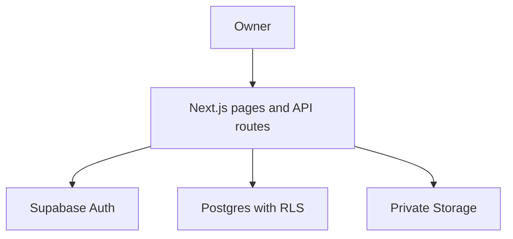

# MMinCare

**Care more, worry less.** A pet-care record management web application and an independent portfolio project for **Business Analysis, Product/Project Management, and Software Testing**.

MMinCare helps dog and cat owners keep pet profiles, vaccination history, medical records, health observations, and care reminders in one place. It does not diagnose conditions or replace veterinary advice.

[Live application](https://m-mincare.vercel.app/) · [Try the demo](https://m-mincare.vercel.app/demo) · [Portfolio Demo guide](docs/PORTFOLIO_DEMO.md) · [Sample dataset](demo/README.md) · [Project status](docs/PROJECT_STATUS.md) · [BA/PM/Tester evidence](docs/PORTFOLIO_EVIDENCE.md)

> **Project phase: Phase 2.1 — read-only Caretaker sharing.** The application supports per-pet invitations, acceptance and revocation. The public demo uses synthetic, browser-local data; demo invitations are simulated, do not send email or grant real access, and reset when the demo reloads. Check individual PRs and CI runs for verification status.

## Problem and intended users

Pet information is often scattered across vaccination books, prescriptions, clinic messages, photos, calendars, and personal notes. Owners need a chronological record to find past care events, track changes, and remember upcoming care dates.

Owners can manage their dogs and cats and invite a Caretaker to view a selected pet. A Caretaker uses their own confirmed account and receives access only after accepting the invitation.

## Portfolio guide

| Focus | Evidence available in this repository |
|---|---|
| BA | [Problem statement](Product/Problem%20statement.md), [personas](Product/Persona%20Document.md), [MVP and MoSCoW](Product/MVP%20document.md), [User Stories](Product/User%20story.md), [business rules](MMinCare_Business_Rules.md), [API design/current route inventory](MMinCare_API_Documentation.md), [data dictionary](Data_Dictionary.md), [Use Case](Use%20Case_MMinCare.drawio), [User Flow](Product/User%20flow%20Web%20theo%20d%C3%B5i%20th%C3%BA%20c%C6%B0ng.drawio), [ERD](ERD%20-%20WEB%20MMin%20Care.drawio) |
| PM/Product | [Delivery status and prioritized backlog](docs/PROJECT_STATUS.md), [architecture decisions](Architecture_Decision_Log.md), merged feature/fix PRs, scope changes based on user feedback |
| Tester/QA | [Requirement-to-test mapping and manual scenarios](docs/PORTFOLIO_EVIDENCE.md), automated regression tests, migration/RLS assertions, [defect report and verification limits](docs/CODE_REVIEW_2026-10-07.md) |

This is an independent project with AI-assisted implementation and review. Repository artifacts demonstrate project work; they do not imply professional employment, a production security certification, or a measured business outcome.

## Implemented Owner workflows

| Area | Current capability |
|---|---|
| Authentication | Email/password signup, email confirmation and resend feedback, login/logout, password recovery, protected sessions |
| Pet profiles | Create, view, edit; optional private JPEG/PNG/WebP upload up to 5 MB; change/remove photo; species avatar fallback; real photos fill a square frame |
| Vaccination and medical history | Record completed vaccinations and medical visits; optional private medical attachments; Owner-confirmed deletion of vaccine/medical records; no edit UI for these records |
| Reminders | Manual or vaccine/medical-linked reminders; Upcoming/Overdue/Completed views; edit eligible Upcoming reminders and mark completed |
| Notification Center | Current in-app events, unread red dot, read/retry state and navigation to the linked reminder |
| Health journal | Create, edit, delete dated weight/food/condition/note observations; deletion confirmation; Enter in the three measurement/food inputs does not save |
| Health summaries | Compact latest-journal summary on pet cards; per-pet weekly/monthly statistics |
| Data access | Authenticated Owner checks in APIs, database RLS, private Storage and Owner-authorized photo delivery |

## Phase 2.1 — Caretaker sharing

An Owner invites a Caretaker by email for one selected pet and an expiry date. The recipient accepts using the matching verified account. The Owner can revoke access; revoked or expired access is blocked on the next request. A person can own their pets and be a Caretaker for another person's pet.

Caretaker access is read-only: basic pet information and text vaccination/medical history. It excludes changes, onward sharing, private photos and attachments, reminders, notifications and health journals. The demo simulates invitation creation and revocation locally; it does not deliver invitations or exercise real authentication, RLS or Storage.

**Typical flow:** register and confirm email → create a pet → record care and health observations → set reminders → review notifications and complete tasks → review history/statistics.

## Business decisions

- A vaccination record describes an event that happened; future dates are rejected. Optional next-date suggestions are currently unavailable because of rule access/data setup (CR-08); when available, they must not silently create reminders.
- A reminder is manual or linked to one vaccine/medical source. Overdue is derived from due date; stored status remains Upcoming until completion.
- Health logs separate the selected business date (`recorded_on`) from the immutable creation timestamp (`logged_at`).
- Optional photos can be removed without making a profile invalid. Private pet photos use an authorized API; medical attachments use authorized signed URLs.
- Medical/vaccine deletion handles linked reminders; medical deletion reports attachment-cleanup warnings. Pet/account hard deletion is not implemented.
- Google OAuth, proactive email/push reminders and multi-pet aggregate analytics remain future work.

## Delivery and quality

The original Owner MVP baseline was main `bcd14b51f4b70cd3d418bd10638f7a996713fdcf` (PR #26). Phase 2.1 was subsequently implemented in [PR #30](https://github.com/lemai-rgb/MMincare/pull/30); [PR #31](https://github.com/lemai-rgb/MMincare/pull/31) reconciles the production migration with repository history. See GitHub for their current status.

Historical checks at `7b777d1` included demo tests, lint, TypeScript, build and [CI](https://github.com/lemai-rgb/MMincare/actions/runs/38068595221). Phase 2.1's Owner/Caretaker flow was exercised using synthetic accounts and local Supabase in [CI](https://github.com/lemai-rgb/MMincare/actions/runs/43139448333). These are not a full production UAT.

PR #22 delivered request lifecycle/idempotency/text fixes; PR #23 responsive layout; PR #24 statistics timestamp/range contract; PR #26 corrected demo parity and fixtures. CR-08 rule access/dataset remains incomplete. Post-delete focus, CI coverage/database advisories and manual QA keep their stated evidence status. See [current status](docs/PROJECT_STATUS.md) and [portfolio evidence](docs/PORTFOLIO_EVIDENCE.md).

Authenticated email/upload/reload/retry, Owner A/B access, full desktop/mobile visual QA and production timings remain unverified. No speedup percentage, adoption metric or formal sign-off is claimed.

## Architecture and stack



Next.js 16.3.5 · React 19.2.4 · TypeScript · CSS modules/Tailwind CSS 4 · Supabase Auth/Postgres/Storage · Vercel · Vitest/Testing Library.

APIs validate authentication and pet ownership; RLS supplies a database authorization boundary. The deployed API uses `/api/...` with SSR cookie sessions. The [API document](MMinCare_API_Documentation.md) now describes actual handlers and request/response contracts; obsolete design-only endpoints are excluded.

## Repository navigation

| Directory/file | Purpose |
|---|---|
| `Product/` | Problem/personas/MVP, current User Stories and User Flow |
| `docs/` | Current status, portfolio traceability/manual scenarios, dated review |
| `app/`, `components/`, `styles/` | Pages, route handlers, feature/shared UI and styles |
| `lib/` | Auth, domain validation, request lifecycle and Supabase helpers |
| `supabase/migrations/` | Versioned migrations; reconcile with remote history before applying |
| `supabase/ci-legacy-baseline.sql` | Legacy snapshot used only by local CI replay |
| `database/` | Schema reference and legacy material; not a second migration source |
| `.github/workflows/` | Migration replay and database assertions |

## Run locally

Requirements: Node.js 20.9+ (CI uses Node 22), npm, and a configured Supabase development project.

```bash
git clone https://github.com/lemai-rgb/MMincare.git
cd MMinCare
npm ci
```

Create `.env.local` using your development project's public settings:

```env
NEXT_PUBLIC_SUPABASE_URL=your_supabase_project_url
NEXT_PUBLIC_SUPABASE_PUBLISHABLE_KEY=your_supabase_publishable_key
```

```bash
npm run dev
```

Open `http://localhost:3000`. Do not expose secret/service-role keys in browser code or `NEXT_PUBLIC_` settings. Do not use production user data as test fixtures.

Available checks:

```bash
npm run test:auth
npm run test:reminders
npm run test:notifications
npm run test:pet-images
npm run test:performance
npm run test:demo
npm run demo:export -- --date 2026-10-10
npx vitest run lib/petHealthSummary.test.ts
npm run lint
npx tsc --noEmit --incremental false
npm run build
```

The summary test is listed separately because it is not included in an npm test script. See the review for CI gaps.

## Deployment and remaining scope

Configure Supabase Site URL/auth redirects, reconcile migrations, and verify private `pet-photos` and `medical-record-attachments` buckets/policies before release. Pet-photo and Health Log edit/delete migrations are already recorded in production at this checkpoint; do not apply them again just to run the project.

Optional `MINCARE_PERF_LOG=1` enables server timing logs with request/stage identifiers and durations. Actual production before/after timings have not been captured; no speed improvement percentage is claimed.

The deployed `/demo` uses shared application components and synthetic per-tab client data, no backend credentials, with Pet, Vaccine/Medical, Reminder/Notification and Health flows. The real application still needs its configured Supabase environment. See [demo scope and acceptance](docs/PORTFOLIO_DEMO.md) before using a demo URL on a CV. Future scope includes controlled sharing, external notifications, OAuth and multi-pet analytics.

## Portfolio access

The [live application](https://m-mincare.vercel.app/) uses authenticated workflows; [public demo](https://m-mincare.vercel.app/demo) is deployed for CV reviewers without registration. It uses the same UI/forms/CSS and3 synthetic Pets, while changes/reset stay browser-local. Repository links require reviewer access if private; do not assume a URL alone grants it. Demo does not prove real Owner isolation, private Storage or backend performance. The11 current product/technical artifacts are synchronized to the application baseline; see the [documentation index](docs/DOCUMENTATION_SYNC.md).
