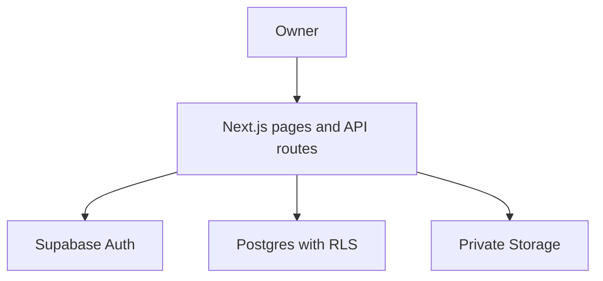

# MMinCare

**Care more, worry less.** A pet-care record management web application and an independent portfolio project for **Business Analysis, Product/Project Management, and Software Testing**.

MMinCare helps dog and cat owners keep pet profiles, vaccination history, medical records, health observations, and care reminders in one place. It does not diagnose conditions or replace veterinary advice.

[Live application](https://m-mincare.vercel.app/) · [Project status](docs/PROJECT_STATUS.md) · [BA/PM/Tester evidence](docs/PORTFOLIO_EVIDENCE.md) · [Latest code review](docs/CODE_REVIEW_2026-10-07.md)

> **Status — 7 October 2026:** Owner MVP deployed; PRs #18–#21 merged. Automated checks pass on the reviewed code, but known defects and authenticated runtime checks remain open. The live application requires an account; a separate seeded portfolio demo is **not implemented**.

## Problem and intended users

Pet information is often scattered across vaccination books, prescriptions, clinic messages, photos, calendars, and personal notes. Owners need a chronological record to find past care events, track changes, and remember upcoming care dates.

The initial scope prioritizes an owner managing dogs or cats. Shared Caretaker access is a future extension, not a current production permission.

## Portfolio guide

| Focus | Evidence available in this repository |
|---|---|
| BA | [Problem statement](Product/Problem%20statement.md), [personas](Product/Persona%20Document.md), [MVP and MoSCoW](Product/MVP%20document.md), [business rules](MMinCare_Business_Rules.md), [API design/current route inventory](MMinCare_API_Documentation.md), [data dictionary](Data_Dictionary.md), [Use Case](Use%20Case_MMinCare.drawio), [ERD](ERD%20-%20WEB%20MMin%20Care.drawio) |
| PM/Product | [Delivery status and prioritized backlog](docs/PROJECT_STATUS.md), [architecture decisions](Architecture_Decision_Log.md), merged feature/fix PRs, scope changes based on user feedback |
| Tester/QA | [Requirement-to-test mapping and manual scenarios](docs/PORTFOLIO_EVIDENCE.md), automated regression tests, migration/RLS assertions, [defect report and verification limits](docs/CODE_REVIEW_2026-10-07.md) |

This is an independent project with AI-assisted implementation and review. Repository artifacts demonstrate project work; they do not imply professional employment, a production security certification, or a measured business outcome.

## Implemented Owner workflows

| Area | Current capability |
|---|---|
| Authentication | Email/password signup, email confirmation and resend feedback, login/logout, password recovery, protected sessions |
| Pet profiles | Create, view, edit; optional private JPEG/PNG/WebP upload up to 5 MB; change/remove photo; species avatar fallback; real photos fill a square frame |
| Vaccination and medical history | Record completed vaccinations and medical visits; optional private medical attachments; Owner-confirmed deletion of vaccine/medical records; no edit UI for these records |
| Reminders | Manual or vaccine/medical-linked reminders; Upcoming/Overdue/Completed views; edit eligible Upcoming reminders and mark completed |
| Notification Center | Current in-app events, unread red dot, read/retry state and navigation to the linked reminder |
| Health journal | Create, edit, delete dated weight/food/condition/note observations; deletion confirmation; Enter in the three measurement/food inputs does not save |
| Health summaries | Compact latest-journal summary on pet cards; per-pet weekly/monthly statistics |
| Data access | Authenticated Owner checks in APIs, database RLS, private Storage and Owner-authorized photo delivery |

**Typical flow:** register and confirm email → create a pet → record care and health observations → set reminders → review notifications and complete tasks → review history/statistics.

## Business decisions

- A vaccination record describes an event that happened; future dates are rejected. Optional next-date suggestions are currently unavailable because of rule access/data setup (CR-08); when available, they must not silently create reminders.
- A reminder is manual or linked to one vaccine/medical source. Overdue is derived from due date; stored status remains Upcoming until completion.
- Health logs separate the selected business date (`recorded_on`) from the immutable creation timestamp (`logged_at`).
- Optional photos can be removed without making a profile invalid. Private pet photos use an authorized API; medical attachments use authorized signed URLs.
- Medical/vaccine deletion handles linked reminders; medical deletion reports attachment-cleanup warnings. Pet/account hard deletion is not implemented.
- Caretaker sharing, OAuth, proactive email/push reminders and multi-pet aggregate analytics are not shipped.

## Delivery and quality

Reviewed application baseline: [`8b91154`](https://github.com/lemai-rgb/MMincare/commit/8b911540ddfb4856d29f414f1e771f0ae22dc989), after [PR #21](https://github.com/lemai-rgb/MMincare/pull/21). This documentation update does not change application code or production data.

Checks performed on 7 October 2026:

- **45 Vitest tests across 11 files passed**, including notifications, photo picker, Health Log UI/API, timeout/retry and validation scenarios.
- Auth error/resend, Reminder edit, Notification selector/reducer and HTTP-timeout script tests passed.
- ESLint, TypeScript and a production build passed.
- Latest relevant [migration replay run #23](https://github.com/lemai-rgb/MMincare/actions/runs/37615187127) passed on the PR #20 feature head. The workflow is path-filtered; not every check runs on every PR.
- Vercel reports successful deployment for the reviewed main commit. Deployment success does not establish loading speed or authenticated functional correctness.

**Open quality work:** unbounded mutation/notification requests, a reproduced Health Log GET/mutation race, a text-validation edge case, post-delete focus recovery, CI coverage, unavailable optional vaccine-date suggestions and database advisory follow-up. See the [review](docs/CODE_REVIEW_2026-10-07.md).

Authenticated upload/reload, cross-Owner access, real email flows, desktop/mobile visual QA and production timings are not verified in this review. See the [manual scenarios](docs/PORTFOLIO_EVIDENCE.md).

## Architecture and stack



Next.js 16.3.5 · React 19.2.4 · TypeScript · CSS modules/Tailwind CSS 4 · Supabase Auth/Postgres/Storage · Vercel · Vitest/Testing Library.

APIs validate authentication and pet ownership; RLS supplies a database authorization boundary. The deployed API uses `/api/...` with SSR cookie sessions. Original API examples are design material; current routes are marked separately in the [API document](MMinCare_API_Documentation.md).

## Repository navigation

| Directory/file | Purpose |
|---|---|
| `Product/` | Problem statement, personas, original MVP prioritization |
| `docs/` | Current status, portfolio traceability/manual scenarios, dated review |
| `app/`, `components/`, `styles/` | Pages, route handlers, feature/shared UI and styles |
| `lib/` | Auth, domain validation, request lifecycle and Supabase helpers |
| `supabase/migrations/` | Versioned migrations; reconcile with remote history before applying |
| `supabase/ci-legacy-baseline.sql` | Legacy snapshot used only by local CI replay |
| `database/` | Schema reference and legacy material; not a second migration source |
| `.github/workflows/` | Migration replay and database assertions |

## Run locally

Requirements: Node.js 20.9+ (CI uses Node 22), npm, and a configured Supabase development project.

```bash
git clone https://github.com/lemai-rgb/MMincare.git
cd MMinCare
npm ci
```

Create `.env.local` using your development project's public settings:

```env
NEXT_PUBLIC_SUPABASE_URL=your_supabase_project_url
NEXT_PUBLIC_SUPABASE_PUBLISHABLE_KEY=your_supabase_publishable_key
```

```bash
npm run dev
```

Open `http://localhost:3000`. Do not expose secret/service-role keys in browser code or `NEXT_PUBLIC_` settings. Do not use production user data as test fixtures.

Available checks:

```bash
npm run test:auth
npm run test:reminders
npm run test:notifications
npm run test:pet-images
npm run test:performance
npx vitest run lib/petHealthSummary.test.ts
npm run lint
npx tsc --noEmit --incremental false
npm run build
```

The summary test is listed separately because it is not included in an npm test script. See the review for CI gaps.

## Deployment and remaining scope

Configure Supabase Site URL/auth redirects, reconcile migrations, and verify private `pet-photos` and `medical-record-attachments` buckets/policies before release. Pet-photo and Health Log edit/delete migrations are already recorded in production at this checkpoint; do not apply them again just to run the project.

Optional `MINCARE_PERF_LOG=1` enables server timing logs with request/stage identifiers and durations. Actual production before/after timings have not been captured; no speed improvement percentage is claimed.

Next priorities are defect fixes and manual regression evidence, then a separate seeded demo with synthetic data. Future scope includes controlled sharing, external notifications, OAuth and multi-pet analytics. See [Project Status](docs/PROJECT_STATUS.md) for priorities and acceptance criteria.

## Portfolio access

The live application uses real authenticated workflows; a future demo would provide safe sample data for recruiters. At this checkpoint, GitHub reports this repository as private. Its URL alone does not grant recruiter access. Decide repository visibility/access explicitly before using the code/documentation link on a CV.
